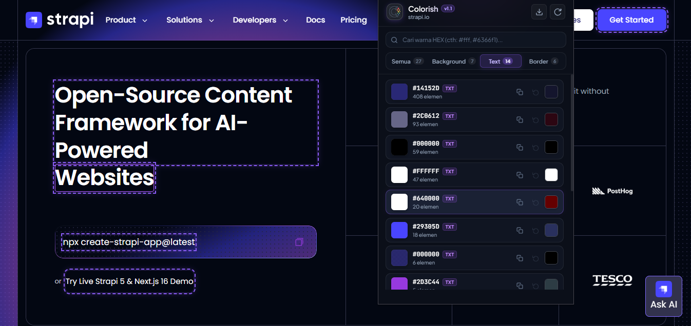
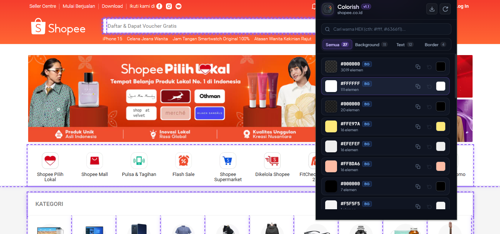

<p align="center">
  
</p>

<h1 align="center">Colorish</h1>

<p align="center">
  <b>Web Color Studio & Live Swapper</b><br>
  Ekstensi Chrome modern untuk mendeteksi, mengganti, dan mengekspor warna website secara real-time.
</p>

<p align="center">
  
  
  
  
</p>

---

## 📸 Contoh Penggunaan (Demo)

<div align="center">
  <h3>1. Inspeksi & Highlight Elemen Teks (strapi.io)</h3>
  
  <br>
  <p><i>Mendeteksi dan menyorot elemen teks pada halaman web saat kursor diarahkan ke kartu warna.</i></p>

  <br>

  <h3>2. Deteksi Warna Background Kompleks (shopee.co.id)</h3>
  
  <br>
  <p><i>Menganalisis ribuan elemen DOM, memilah background warna, dan mengganti warna secara real-time.</i></p>
</div>

---

## ✨ Fitur Utama

- 🎨 **Live Color Swap**: Ubah warna elemen website apa pun (`background`, `text`, `border`) secara instan dengan color picker terintegrasi.
- 🔍 **Deteksi Otomatis & Terkategori**: Memindai seluruh DOM dan mengelompokkan warna ke dalam tab **Semua**, **Background**, **Text**, dan **Border** berdasarkan frekuensi penggunaan.
- ⚡ **Pencarian Cepat**: Filter warna berdasarkan kode HEX (misal `#fff`, `#6366f1`) dengan kotak pencarian interaktif.
- 📋 **Satu Klik Salin (One-Click Copy)**: Klik kode HEX atau tombol salin untuk langsung menyalin ke clipboard lengkap dengan animasi umpan balik.
- 👁️ **Hover Highlight**: Sorot elemen di halaman web saat mengarahkan kursor ke kartu warna di popup.
- 📦 **Export Palet Warna**: Ekspor seluruh palet warna halaman ke dalam berbagai format standar:
  - **CSS Custom Properties** (`:root { --color-1: ... }`)
  - **Tailwind CSS Config** (`colors: { ... }`)
  - **HEX List**
  - **JSON Array**
- 🔄 **Reset Fleksibel**: Kembalikan satu warna tertentu atau reset semua perubahan sekaligus (*Reset All*).
- 🌙 **Desain Modern OLED / Glassmorphism**: Tampilan gelap elegan dengan font [Plus Jakarta Sans](https://fonts.google.com/specimen/Plus+Jakarta+Sans) dan [JetBrains Mono](https://fonts.google.com/specimen/JetBrains+Mono).

---

## 🚀 Cara Instalasi di Browser

Ekstensi ini mendukung browser berbasis Chromium seperti **Google Chrome**, **Microsoft Edge**, **Brave**, dll.

1. **Clone atau Unduh repositori ini**:
   ```bash
   git clone https://github.com/regamadila/colorish.git
   ```
2. Buka browser dan arahkan ke halaman ekstensi:
   - Chrome: `chrome://extensions`
   - Edge: `edge://extensions`
   - Brave: `brave://extensions`
3. Aktifkan **Developer mode** (Mode Pengembang) di pojok kanan atas.
4. Klik tombol **Load unpacked** (Muat yang belum dibongkar).
5. Pilih folder proyek `colorish`.
6. Ekstensi **Colorish** siap digunakan! Pasang (pin) di toolbar untuk akses cepat.

---

## 📁 Struktur Direktori

```
colorish/
├── assets/             # Dokumentasi screenshot & demo visual
│   ├── demo-strapi.png
│   └── demo-shopee.png
├── icons/              # Ikon ekstensi (16x16, 48x48, 128x128)
│   ├── icon16.png
│   ├── icon48.png
│   └── icon128.png
├── colorish_logo.png   # Master asset logo
├── manifest.json       # Konfigurasi ekstensi Chrome (Manifest V3)
├── popup.html          # Struktur antarmuka popup
├── popup.css           # Sistem desain & styling antarmuka
├── popup.js            # Logika antarmuka, filter, export, dan state
├── content.js          # Content script (inspeksi DOM & manipulasi CSS)
├── .gitignore          # Git ignore rules
└── README.md           # Dokumentasi proyek
```

---

## 🔒 Privasi & Keamanan

Colorish hanya memerlukan izin `activeTab` dan berjalan 100% secara lokal di browser Anda. Tidak ada data pribadi, halaman web, atau informasi yang dikirimkan ke server eksternal.

---

## 📄 Lisensi

Proyek ini dilisensikan di bawah lisensi [MIT](LICENSE).
